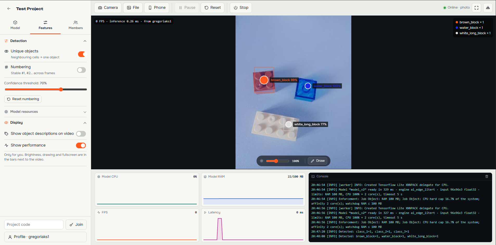
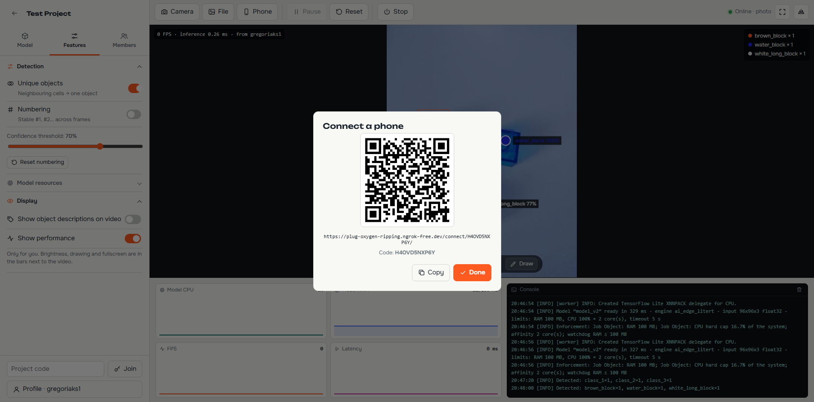
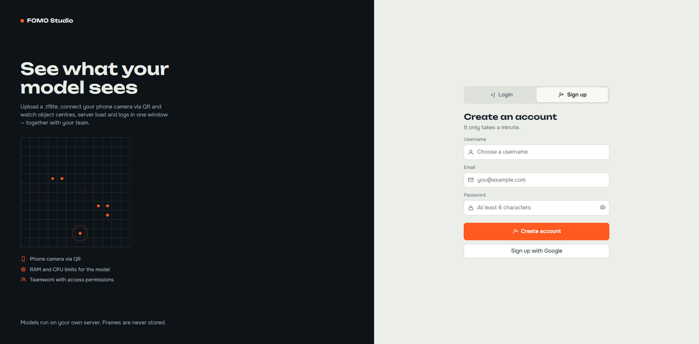

# FOMO Studio

FOMO Studio is a web application for running FOMO object-detection models on live video. Upload a `.tflite` model, connect a camera or phone, and review detections, performance, and logs in one shared project.



## Features

- TFLite/FOMO inference on CPU through `ai-edge-litert`
- Camera, local video, and phone input via QR code
- Live detections, confidence threshold, object grouping, and tracking
- Per-project members, invitations, and upload/control permissions
- Isolated inference worker with configurable RAM, CPU, and timeout limits
- SQLite by default, with MySQL and Redis support through environment variables

## Local setup

Requirements: Python 3.10+ and a working C/C++ runtime for the TFLite package.

```bash
git clone <repository-url>
cd python

python -m venv .venv
# Windows
.venv\Scripts\activate
# macOS/Linux
source .venv/bin/activate

pip install -r requirements.txt
copy .env.example .env        # Windows
# cp .env.example .env        # macOS/Linux

python manage.py migrate
python manage.py createsuperuser
daphne -b 127.0.0.1 -p 8000 config.asgi:application
```

Open [http://127.0.0.1:8000](http://127.0.0.1:8000) and create an account.

For development, Django's server also works:

```bash
python manage.py runserver
```

## Configuration

The default configuration uses SQLite and stores uploaded models under `media/`. Copy `.env.example` to `.env` and set values as needed.

Important settings:

| Variable | Purpose | Default |
|---|---|---|
| `DJANGO_SECRET_KEY` | Django secret key | development fallback |
| `DJANGO_DEBUG` | Debug mode | `1` |
| `DB_ENGINE` | Database backend | SQLite |
| `REDIS_URL` | Optional Channels backend | in-memory |
| `FOMO_MAX_RAM_MB` | Worker memory limit | `100` |
| `FOMO_HARD_MEMORY` | Enforce the worker memory limit | `1` |
| `MEDIA_ROOT` | Uploaded model directory | `./media` |

### Email verification

The application sends one-time verification codes through SMTP. For Gmail, enable 2-Step Verification, create an App Password, and set:

```env
EMAIL_HOST=smtp.gmail.com
EMAIL_PORT=587
EMAIL_USE_TLS=1
EMAIL_HOST_USER=your.address@gmail.com
EMAIL_HOST_PASSWORD=your-16-character-app-password
DEFAULT_FROM_EMAIL=FOMO Studio <your.address@gmail.com>
```

Restart the application after changing `.env`. For another provider, use its SMTP host, port, TLS setting, username, and password.

### Google sign-in and ngrok

Google OAuth and phone camera access need a public HTTPS URL. Run the application locally, then start ngrok:

```bash
ngrok http 8000
```

Copy the HTTPS forwarding URL, for example `https://example.ngrok-free.app`, and update `.env`:

```env
DJANGO_DEBUG=1
ALLOWED_HOSTS=example.ngrok-free.app,localhost,127.0.0.1
CSRF_ORIGINS=https://example.ngrok-free.app
GOOGLE_CLIENT_ID=your-google-client-id
GOOGLE_CLIENT_SECRET=your-google-client-secret
```

In Google Cloud Console, configure the OAuth client as follows:

- **Authorized JavaScript origins:** `https://example.ngrok-free.app`
- **Authorized redirect URI:** `https://example.ngrok-free.app/accounts/complete/google-oauth2/`

The ngrok URL changes between sessions unless you use a reserved domain. Update both Google Cloud Console and `.env` when the URL changes.

Set `DJANGO_DEBUG=0`, a strong `DJANGO_SECRET_KEY`, explicit `ALLOWED_HOSTS`, and production email/database settings before deployment.

## Models

Upload a TensorFlow Lite model from the **Model** panel. The runtime expects a FOMO-style output tensor shaped like `[1, height, width, classes]`; other output shapes are accepted but reported as unsupported for FOMO post-processing.

The model runs in a separate process. On Windows, models stored under paths containing non-ASCII characters are copied to a temporary ASCII path for TFLite compatibility.

## Phone input

Use **Phone** in a project workspace to generate a QR code. Scan it on the phone and allow camera access. Camera access requires HTTPS when the app is not running on localhost.





## Project layout

```text
config/       Django settings, ASGI and URL configuration
studio/       projects, models, WebSocket consumers and inference runtime
accounts/     authentication
templates/    server-rendered pages
static/       frontend assets
demo/         screenshots
media/        uploaded models and user media
```

## License

No license has been specified yet.
